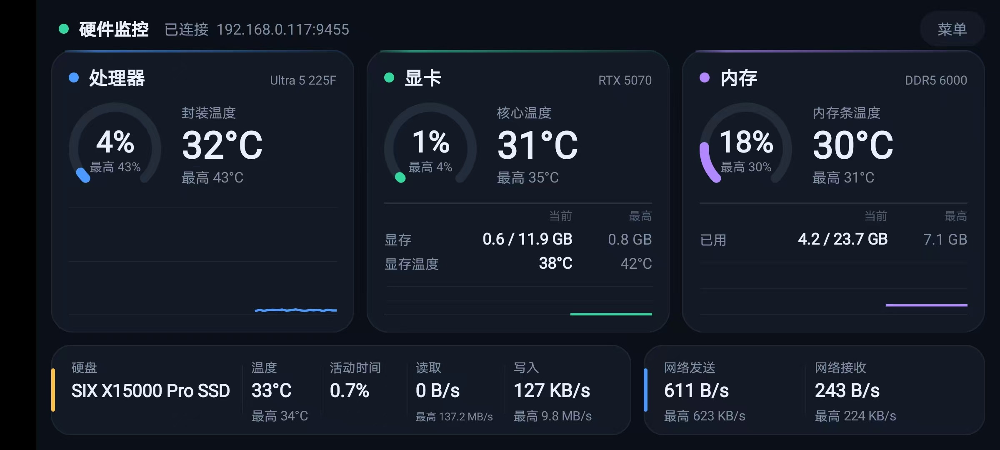

# HwMonitor · Windows 硬件监控采集端

[](https://github.com/ZZC-VB/hwmonitor/actions/workflows/build.yml)
[](LICENSE)

一个**只有托盘图标**的 Windows 硬件数据采集端。把 CPU、显卡、内存、硬盘、网卡的实时状态，通过局域网 TCP 持续推给手机或任何你写的客户端。

> A headless Windows hardware monitor that streams CPU / GPU / memory / disk / network metrics over LAN as NDJSON.

写它的原因很实际：全屏游戏或专注干活时，想瞄一眼温度和占用，又不想为此买一块副屏。手机上那个客户端是配套写的（不在本仓库），PC 这边则刻意做到「没有界面、没有配置、没有日志」——双击之后除了托盘图标，什么都不占。

## 界面预览

配套的安卓客户端长这样（本仓库只开源 PC 采集端，手机端源码暂未公开）：



三张卡片依次是处理器、显卡、内存：环形是当前占用，旁边大字是温度，右下角曲线是最近 60 个采样点的走势。底部两条是硬盘（温度 / 活动时间 / 读写）和网络收发。灰色小字「最高」是本次连接以来的峰值，菜单里可重置。

> 图中 IP 与硬件型号来自开发机，仅作示例。客户端锁定横屏，所以截图也是横的。

## 特点

- **零界面**：无窗口、无配置文件、无日志文件。托盘右键只有「地址」「状态」「退出」
- **轻**：单帧约 280 字节，1 Hz 下约 2.2 kbps；无客户端连接时不分配任何缓冲区
- **采样频率可远程改**：客户端发一条 `{"c":"interval","v":秒}` 即可，1~60 秒，PC 端不落盘
- **自动发现**：UDP 广播，同一网段内客户端不用手输 IP
- **不依赖 Visual Studio / NuGet**：仓库自带 `build.bat`，调用系统自带的 `vbc.exe` 就能编译

## 采集什么

| 分组 | 字段 | 说明 |
|---|---|---|
| CPU | 封装温度 / 总占用 / 简短型号 | 温度需 ring0 驱动 |
| 显卡 | 核心温度 / 核心占用 / 显存温度 / 显存已用 / 显存总量 / 型号 | 显存单位 MB |
| 内存 | 内存条温度 / 占用率 / 已用 / 总量 / 型号 | 已用与总量单位 GB |
| 硬盘 | 每块盘的温度 / 活动时间 / 读取速率 / 写入速率 | 活动时间 = 100 − `% Idle Time`，与任务管理器同口径 |
| 网络 | 发送速率 / 接收速率 | 所有可用网卡合计，单位 B/s |

取不到的指标一律输出 `null`，客户端显示 `--`，**不会用 0 冒充**。

刻意没做的：CPU / GPU 频率（LHM 在 Arrow Lake 上读数明显错误）、风扇转速、整机功耗、显存占用率（可由已用 / 总量算出）。理由都是「客户端不显示的东西不采集」。

## 数据从哪来

| 来源 | 用途 |
|---|---|
| [LibreHardwareMonitorLib](https://github.com/LibreHardwareMonitor/LibreHardwareMonitor) 0.9.6 | 温度、显存、硬盘 SMART、内存 SPD |
| `GlobalMemoryStatusEx` | 内存总量 / 可用 |
| WMI（`Win32_PhysicalMemory`） | 内存频率与代际，拼成型号 |
| PDH 性能计数器 | 硬盘读写、`% Idle Time` |
| `NetworkInterface` 统计 | 网卡收发字节数 |

CPU 温度要读 MSR，必须有 ring0 驱动。LHM 0.9.5 之后改用签名驱动 [PawnIO](https://github.com/namazso/PawnIO)，本程序启动时若检测不到会自动静默安装随包的 `PawnIO_setup.exe`。没有驱动也能跑，只是 CPU 温度与硬盘温度显示 `--`。

## 快速开始

> **只想用，不想编译？** 直接下 [Releases](https://github.com/ZZC-VB/hwmonitor/releases) 里的 `HwMonitor-2.5-win-x64.zip`，解压后双击 `HwMonitor.exe` 即可，无需安装 .NET 或任何编译环境。

### 环境

- Windows 10 / 11 x64
- .NET Framework 4.8（系统自带）
- **管理员权限**：读 MSR、SMART 以及自动配置防火墙规则都需要

### 1. 准备第三方依赖（本仓库不含二进制）

`libs/` 里的 DLL 全部是第三方组件，按各自许可分发，因此没有入库。获取方式：

1. 打开 LibreHardwareMonitor 的 Releases 页面，下载 **0.9.6** 的 `LibreHardwareMonitor.zip`（6.4 MB，这是 .NET Framework 4.7.2 版本；另一个 `LibreHardwareMonitor.NET.10.zip` 是 .NET 10 版本，不要用）
2. 解压，把其中所有 `.dll` 复制到本仓库的 `libs/` 目录
3. （可选）想让 CPU 温度可用，把 [PawnIO](https://github.com/namazso/PawnIO) 的 `PawnIO_setup.exe` 放进 `tools/`

`libs/` 下应有的文件清单见 [`libs/README.md`](libs/README.md)。

### 2. 编译

```bat
build.bat
```

产物在 `bin\Release\`，需要连同 `libs\*.dll` 一起分发（`build.bat` 会自动复制）。也可以直接用 Visual Studio 2019+ 打开 `HwMonitor.vbproj`。

不想在本地准备依赖也可以：每次提交到 `main`，GitHub Actions 会自动下载 LHM 依赖、编译并校验文件版本，编译好的整包在 [Actions](https://github.com/ZZC-VB/hwmonitor/actions/workflows/build.yml) 页面的 Artifacts 里，保留 7 天。

### 3. 运行

双击 `bin\Release\HwMonitor.exe`，会弹一次 UAC。点「是」后托盘出现图标，菜单第一行就是本机地址，例如 `192.168.1.5:9455`。

## 协议

### 推流（TCP 9455）

服务端单向推送，每个连接一个 8 帧的有界队列，满了丢最旧的——采集线程永远不会被慢客户端阻塞。每帧一行 NDJSON，`\n` 结尾：

```json
{"ts":1762311543210,
 "cpu":{"l":12.4,"t":58.0,"m":"Ultra 5 225F"},
 "mem":{"l":46.1,"t":41.5,"u":14.8,"a":31.9,"m":"DDR5 5600"},
 "gpu":{"l":7.0,"t":39.0,"mt":44.0,"mu":1204.0,"mv":12288.0,"m":"RTX 5070"},
 "net":{"s":2441.0,"r":18733.0},
 "disks":[{"n":"Samsung SSD 990 PRO 2TB","t":41.0,"u":3.2,"r":0.0,"w":18432.0}]}
```

| 字段 | 含义 | 单位 |
|---|---|---|
| `ts` | Unix 毫秒时间戳（UTC） | ms |
| `cpu.l` / `cpu.t` | 总占用 / 封装温度 | % / °C |
| `mem.l` / `mem.u` / `mem.a` | 占用率 / 已用 / 总量 | % / GB / GB |
| `gpu.l` / `gpu.t` / `gpu.mt` | 核心占用 / 核心温度 / 显存温度 | % / °C / °C |
| `gpu.mu` / `gpu.mv` | 显存已用 / 显存总量 | MB |
| `net.s` / `net.r` | 发送 / 接收速率 | B/s |
| `disks[].u` | 活动时间（与任务管理器「活动时间」同口径） | % |
| `disks[].r` / `disks[].w` | 读 / 写速率 | B/s |
| `*.m` | 简短型号，取不到时该字段整个不出现 | — |

新连接建立时会立刻补发最近一帧，客户端不用等下一个采样周期。

### 发现（UDP 9456）

程序每 1.2 秒向广播地址发一次探测，客户端监听该端口即可拿到机器名与 IP：

```json
{"m":"HWST","v":1,"n":"DESKTOP-XXXX","ip":"192.168.1.5","port":9455}
```

### 命令（客户端 → PC）

连上后向 9455 写入一行即可，目前只有采样间隔：

```json
{"c":"interval","v":3}
```

`v` 为 1~60 的整数秒，越界忽略。多台客户端同时连接时以最后收到的为准。**PC 端不保存这个值**，所以每次重连后客户端都要重新下发一次。

解析是手写的字符串匹配，不引 JSON 库——报文由自己的客户端生成，格式受控。非命令行直接丢弃，不会因此断开连接。

## 自己写一个客户端

最短路径：

1. 监听 UDP 9456，收到 `{"m":"HWST",...}` 就拿到 IP
2. TCP 连上该 IP 的 9455，按行读 JSON
3. 需要省电就把间隔调大，发一行 `{"c":"interval","v":5}`

`tools/mock_server.py` 可以在没有 Windows 硬件的情况下模拟服务端，方便先做界面。

## 已知限制

- 只测过 NVIDIA + Intel 平台，AMD 显卡与核显未验证
- 多块硬盘时，活动时间与读写速率是 `_Total` 合计值，不是逐盘精确值
- 笔记本的传感器命名差异较大，部分指标可能显示 `--`
- 反作弊可能拦截 ring0 驱动（PawnIO 为签名驱动，已知 Faceit 会拦截）
- 端口没选 8080 这类常见值，是为了避开微信小程序的端口黑名单

## 关于作者

**小左**（ZZC-VB）· 独立开发者，济南。二十年五个行业，七十多个项目上线——仓储管理、控制系统、PDA、上位机与数据看板，从需求到上线一个人交付。

这个项目属于同一类活：没有产品经理，没有排期会，从传感器读数取到哪一位，到手机屏幕上那条曲线怎么画，都是自己定的。

个人站：<http://47.105.60.173:8100>　·　GitHub：[@ZZC-VB](https://github.com/ZZC-VB)

## 许可

本项目代码以 [MIT](LICENSE) 许可发布。

第三方组件遵循各自许可：LibreHardwareMonitorLib 为 MPL-2.0，HidSharp 为 Apache-2.0，其余 Microsoft.* / System.* 包为 MIT。分发时请保留 `libs/` 内的原始 DLL 与其许可声明。本项目通过动态引用使用 LibreHardwareMonitorLib，未修改其源码。
